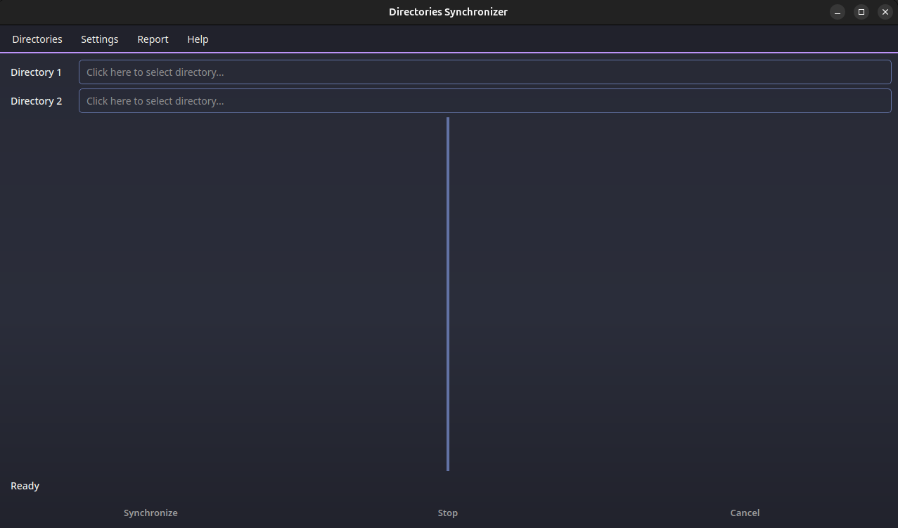
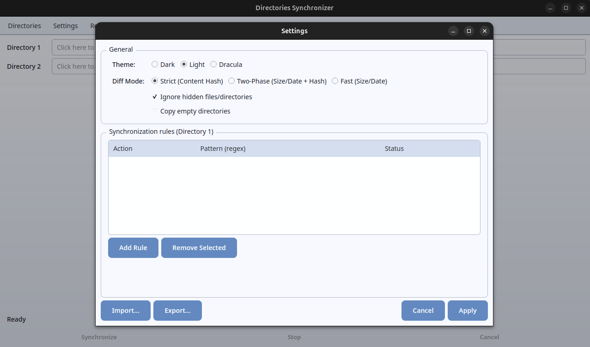
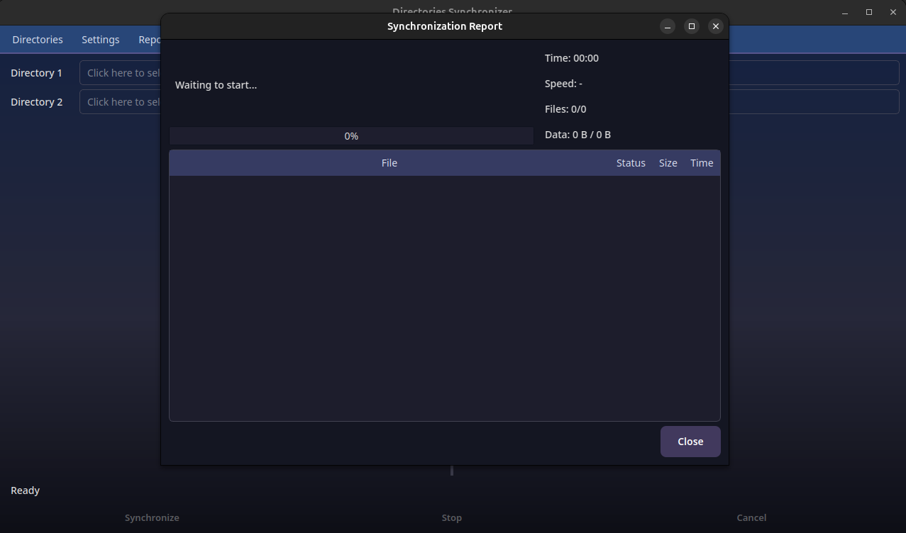

# Compareror

[](https://www.python.org/downloads/)
[](LICENSE)
[](https://github.com/astral-sh/ruff)
[](https://www.riverbankcomputing.com/software/pyqt/)
[](https://pyinstaller.org/)
[](#prerequisites)
[](https://docs.astral.sh/ruff/formatter/)
[](#)
[](#)

> A PyQt6 desktop application for visual directory comparison and safe one-way synchronization (Directory 1 -> Directory 2).

## Screenshots

### Main Window (Dracula Theme)



### Settings Dialog (Light Theme)



### Synchronization Report



## Overview

Compareror is built around a layered architecture with a strategy-driven synchronization core:

- **Facade:** `DirectorySyncModel` coordinates scan -> diff -> sync -> rollback.
- **Strategy Pattern:** scanner, hash, diff, and executor implementations are pluggable.
- **StrategyRegistry:** global thread-safe registries resolve strategy implementations lazily.
- **Safe Execution:** synchronization creates backups before overwrite and supports rollback after cancel/error.

## Current Architecture Snapshot

The implementation is mapped in the Mermaid diagrams listed below. They describe module dependencies, synchronization ordering and current limitations.

- [x] `ensure_strategies_registered()` bootstrap (once-only, thread-safe registration)
- [x] Diff modes: `strict`, `two-phase` (default), `fast`
- [x] `CachingHashProvider` decorator for hash reuse by `(path, size, mtime)`
- [x] `LazyDirectoryTreeWidget` + `HighlightProxyModel` as active UI tree system
- [x] Regex filtering with validation of selected risky constructs (nested quantifier + lookbehind checks)
- [x] Real-time sync statistics in `ReportDialog` (throttled updates)
- [x] Optional empty-directory propagation (`copy_empty_dirs`)
- [x] Core and Qt integration tests

## Architecture Layers

| Layer | Core modules | Responsibility |
| --- | --- | --- |
| Entry Point | `main.py` | App startup, strategy bootstrap, theme provider wiring |
| Presentation | `ui/main_window.py`, `ui/lazy_directory_tree.py`, dialogs, worker threads | User interactions, async orchestration, tree rendering |
| Domain | `sync/directory_sync_model.py`, `sync/interfaces.py`, `sync/bootstrap.py`, `sync/utils.py` | Core sync workflow, contracts, registry lookup, utility primitives |
| Strategy Implementations | `sync/strategies.py` | Default scanner/hash/diff/executor implementations |
| Configuration | `app_settings.py`, `settings.yaml` | Settings model, validation, YAML persistence, regex rule compilation |

## Technical Documentation and Mermaid Diagrams

Diagrams in `architecture/` use fenced Mermaid blocks in Markdown:

- [component_diagram.md](architecture/component_diagram.md) — system-level dependencies and flow
- [strategy_pattern.md](architecture/strategy_pattern.md) — protocols, registries, implementations and data
- [sequence_sync.md](architecture/sequence_sync.md) — compare/sync/stop/cancel/rollback runtime sequence
- [settings_diagram.md](architecture/settings_diagram.md) — settings, YAML persistence and filtering
- [ui_class_diagram.md](architecture/ui_class_diagram.md) — UI classes, workers and theme system
- [test_architecture.md](architecture/test_architecture.md) — tests mapped to source responsibilities

## Feature Set

- [x] Visual side-by-side comparison with highlighted differences
- [x] Three diff strategies (`strict`, `two-phase`, `fast`)
- [x] Parallel hashing/copying (multiprocessing pool)
- [x] Hash caching via `CachingHashProvider`
- [x] Cancel + rollback safety model
- [x] Regex include/exclude rules with validation of selected risky constructs
- [x] Hidden-file filtering
- [x] Empty directory copy support (`copy_empty_dirs`)
- [x] Theme system (`dark`, `light`, `dracula`) via `ThemeManager`
- [x] Live sync statistics and status reporting
- [ ] Sync profiles (planned)
- [ ] Configurable executor swapping (process/thread) (planned)
- [ ] Headless/CLI mode (planned)

## Installation

### Prerequisites

- Python **3.10+** (project currently developed on 3.13.7)
- Windows / Linux / macOS

### Run from source

```bash
python -m venv .venv

# Windows
.venv\Scripts\activate

# Linux/macOS
# source .venv/bin/activate

pip install -r requirements.txt
python main.py
```

### Development dependencies

```bash
pip install -r requirements-dev.txt
```

## Usage

1. Select **Directory 1** (source) and **Directory 2** (target).
2. Click compare (auto-triggered after valid selection) to build diff highlights.
3. Start synchronization to copy/replace needed files.
4. Use **Stop** to halt processing, or **Cancel** to halt and rollback.

### `settings.yaml` example

```yaml
theme: dark
ignore_hidden: true
copy_empty_dirs: false
diff_mode: two-phase      # strict | two-phase | fast
regex_rules:
  - action: exclude
    pattern: '.*\.tmp$'
  - action: include
    pattern: '.*\.py$'
```

## Build Executables

`build.py` wraps PyInstaller and applies platform-aware output paths:

- output: `dist/<platform>/`
- build cache: `build/<platform>/`
- bundled data files: `settings.yaml`, `settings_export.yaml`, `icon_for_program.png`
- Windows icon handling:
  - auto-converts `icon_for_program.(png|jpg|jpeg)` to `.ico` when Pillow is available
  - falls back to existing `.ico` if present

```bash
pip install -r requirements.txt pyinstaller

# Optional (Windows icon auto-conversion support)
pip install Pillow

python build.py
```

## Development

### Tests

```bash
pytest tests/
pytest tests/ --cov=sync --cov=ui --cov=app_settings --cov-report=term
```

### Ruff (lint + format)

```bash
ruff check .
ruff format --check .
```

### CI

GitHub Actions:

1. `ci.yml`: Ruff lint/format + pytest matrix (Python 3.11/3.12/3.13 on Ubuntu + Windows)
2. `build.yml`: PyInstaller builds for Windows/Linux/macOS

## Project Structure

```text
compareror/
├── main.py
├── app_settings.py
├── build.py
├── pyproject.toml
├── requirements.txt
├── requirements-dev.txt
├── settings.yaml
├── settings_export.yaml
├── sync/
│   ├── bootstrap.py
│   ├── directory_sync_model.py
│   ├── interfaces.py
│   ├── strategies.py
│   └── utils.py
├── ui/
│   ├── main_window.py
│   ├── lazy_directory_tree.py
│   ├── settings_dialog.py
│   ├── report_dialog.py
│   ├── help_dialog.py
│   ├── about_dialog.py
│   ├── workers.py
│   ├── theme_manager.py
│   ├── theme_provider.py
│   └── constants.py
├── architecture/
│   ├── component_diagram.md
│   ├── strategy_pattern.md
│   ├── sequence_sync.md
│   ├── settings_diagram.md
│   ├── ui_class_diagram.md
│   └── test_architecture.md
├── tests/
│   ├── conftest.py
│   └── test_*.py
└── .github/workflows/
    ├── ci.yml
    └── build.yml
```

## License

Licensed under **GNU Affero General Public License v3.0 or later**. See [LICENSE](LICENSE).

---

**Status:** Active development · v1.0.0
