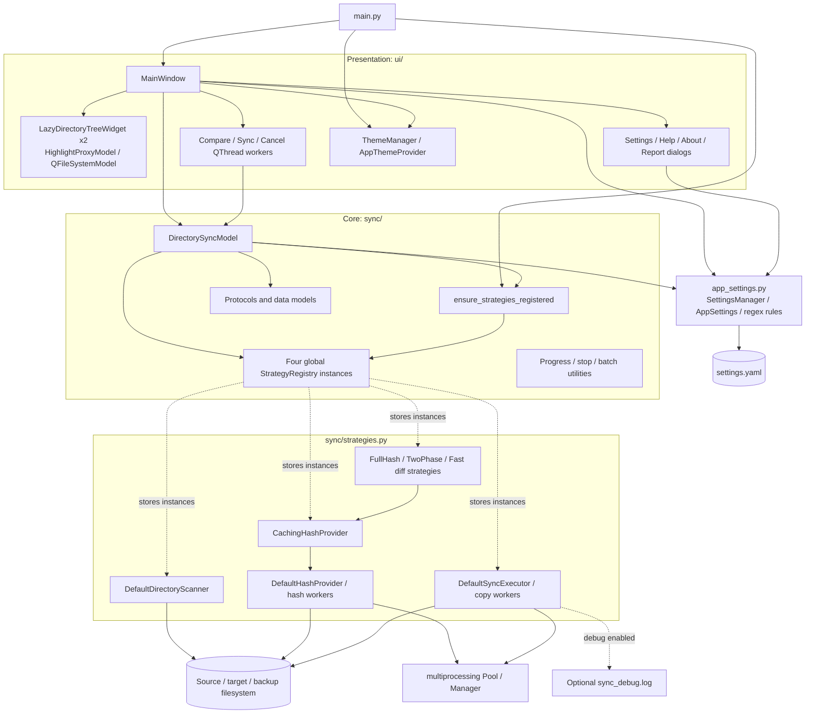

# Component dependencies

Current implementation, inspected 2026-10-05. This diagram groups related classes to keep the dependency graph readable.

Sources: [entry point](../main.py), [model](../sync/directory_sync_model.py), [registry/contracts](../sync/interfaces.py), [strategies](../sync/strategies.py), [UI](../ui/main_window.py), [configuration](../app_settings.py).

Registry locking protects registration/lookup, not concurrent operations on the stored executor. Utilities are shown as available core helpers; the graph does not imply that every strategy uses them. Retired UI modules are absent from the current tree.
