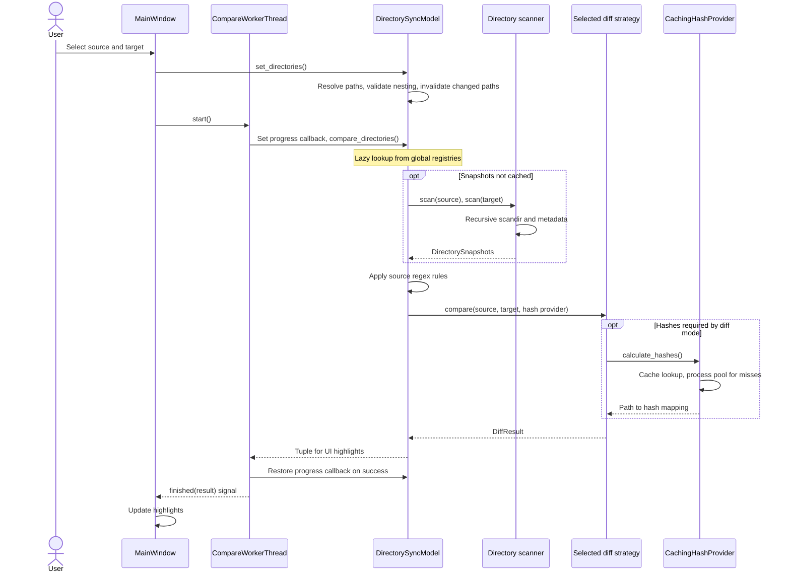
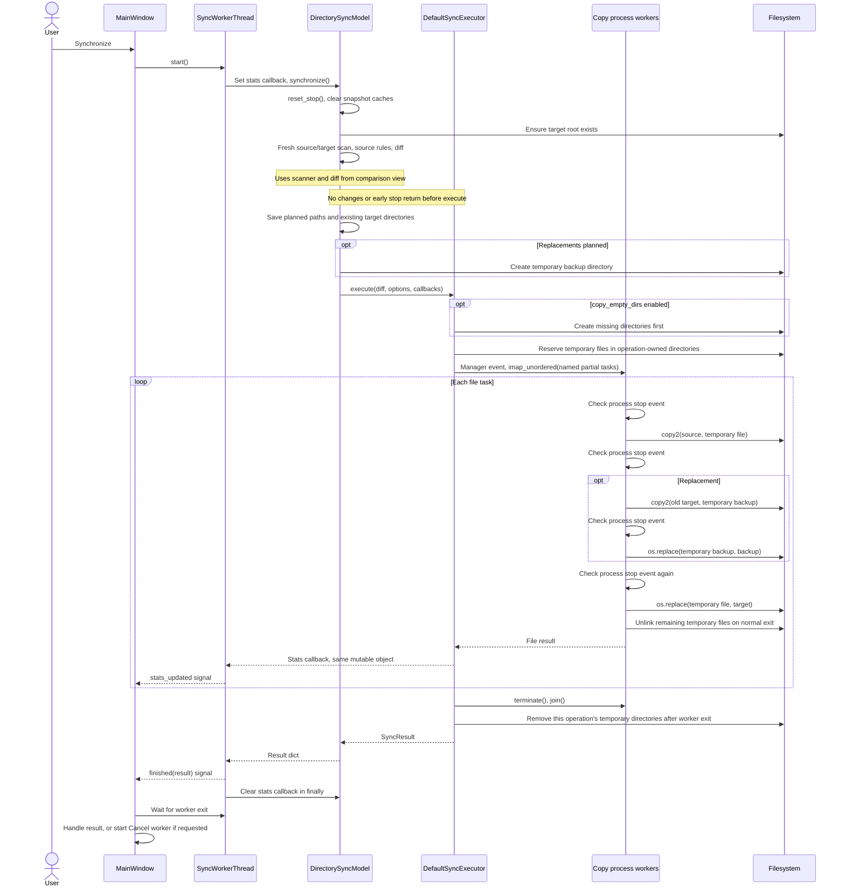
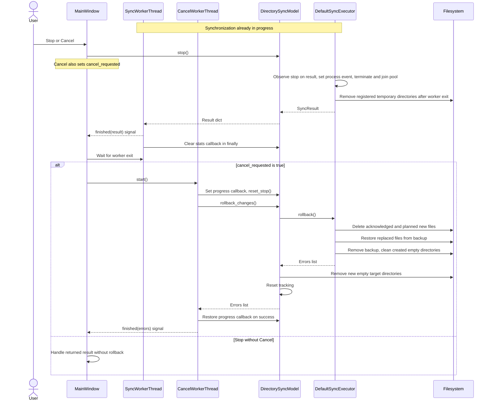

# Compare, synchronize and cancel

Current implementation, inspected 2026-10-05. The phases are separated so each view can be read without a project-wide set of lifelines. These diagrams describe existing ordering, not atomic cancellation or automatic rollback on errors.

## Selection and comparison

Scanner reads the filesystem; cache misses use process workers for file reads and MD5. These calls are summarized inside their responsible participants. Compare errors currently become an empty result; callback restoration is not in `finally`.

## Synchronization

Model rebuilds filesystem snapshots for sync but retains the hash cache. The copy worker installs fully prepared files; backup and target temporary files live on their respective destination filesystems. The result has no dedicated stopped status; UI handling depends on how and when stop was observed. Error/stop paths skip the pending installation.

## Stop and Cancel during synchronization

This view shows stop observed during executor result consumption. Earlier stop may produce a model error result. Cancel is handled only while sync is running; a normal error without `cancel_requested` does not automatically start rollback.

Sources: [MainWindow handlers](../ui/main_window.py), [workers](../ui/workers.py), [model](../sync/directory_sync_model.py), [executor and copy workers](../sync/strategies.py).

`finished(result)` precedes full thread exit. Cancellation can interrupt temporary writes; complete installations may be missing from the acknowledged journal. Backup removal can still occur after restore errors. These are current limitations, not requirements to preserve.
