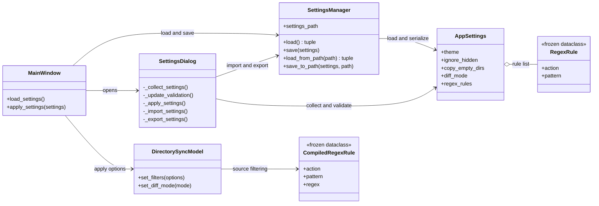
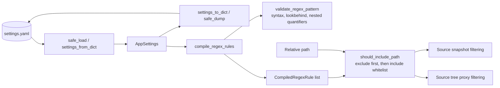

# Settings and filtering

Current implementation, inspected 2026-10-05. Data classes and persistence live in [app_settings.py](../app_settings.py); controls live in [SettingsDialog](../ui/settings_dialog.py).

Model defaults: `dark`, hidden ignored, empty directory propagation disabled, `two-phase`. The checked-in [settings.yaml](../settings.yaml) selects `strict`. Valid themes are dark/light/dracula; diff keys are strict/two-phase/fast.

Exclude matches win; include rules form a whitelist when present. Source core filtering also considers directory paths; the UI proxy keeps directories visible. Regex checks reject selected constructs but do not prove every accepted pattern has bounded runtime. Tests: [settings](../tests/test_app_settings.py), [settings UI](../tests/test_settings_dialog_ui.py), [tree](../tests/test_lazy_directory_tree.py).
