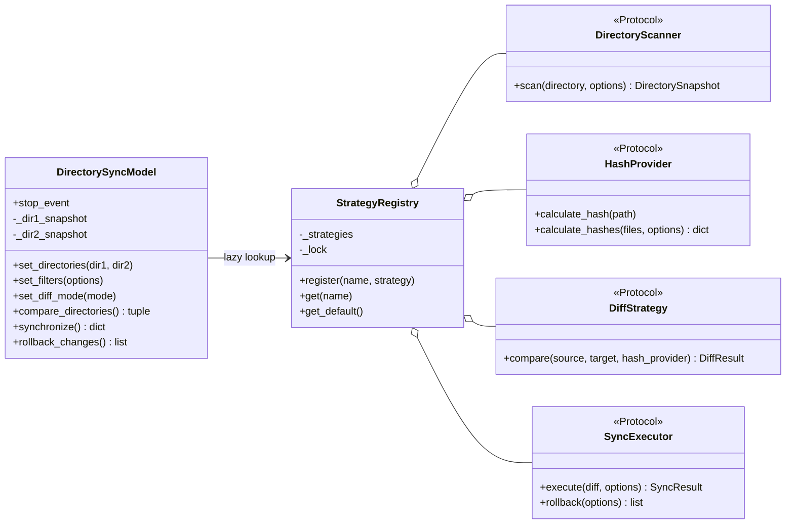
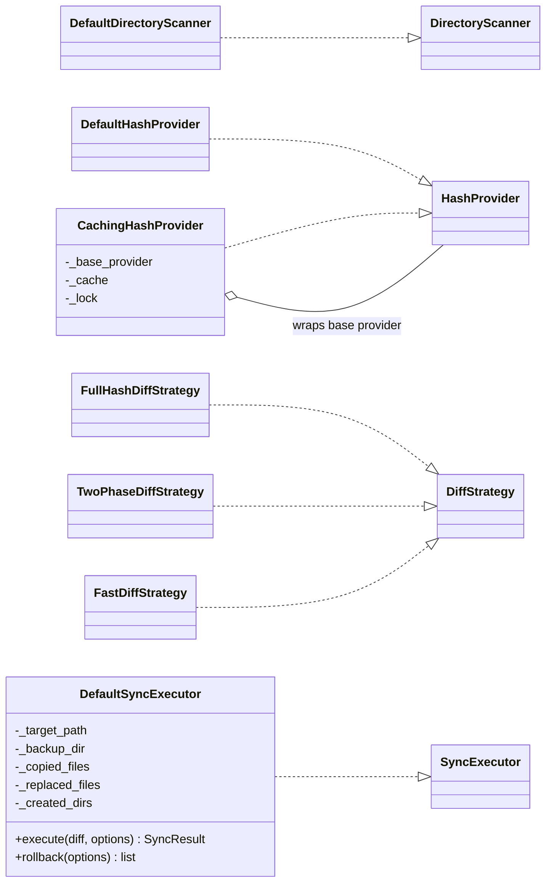
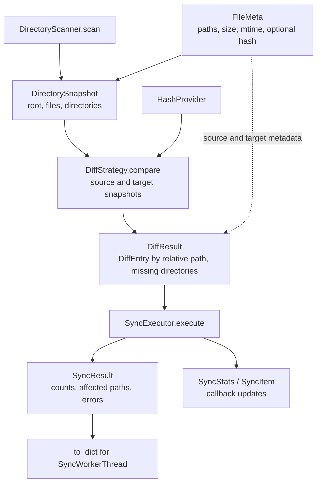

# Strategies, contracts and results

Current implementation, inspected 2026-10-05. The views separate selection, implementations and data flow. Members show important responsibilities, not full Python signatures. Protocol realization uses structural typing, not required Python inheritance.

## Selection and contracts

Four global registries hold shared instances; bootstrap registers them once under a lock. Defaults are scanner `default`, hash `cached`, executor `default`; the model selects diff mode by key. Model/AppSettings default to `two-phase`, while the repository settings file selects `strict`.

## Concrete implementations

The hash cache keys on `(path, size, mtime)` and wraps batch hashing. The executor journal belongs to its instance, not a separate operation object. Registry lookup does not isolate the executor journal between overlapping operations.

## Data between operations

Sources: [contracts and models](../sync/interfaces.py), [coordinator](../sync/directory_sync_model.py), [implementations and defaults](../sync/strategies.py), [bootstrap](../sync/bootstrap.py).
