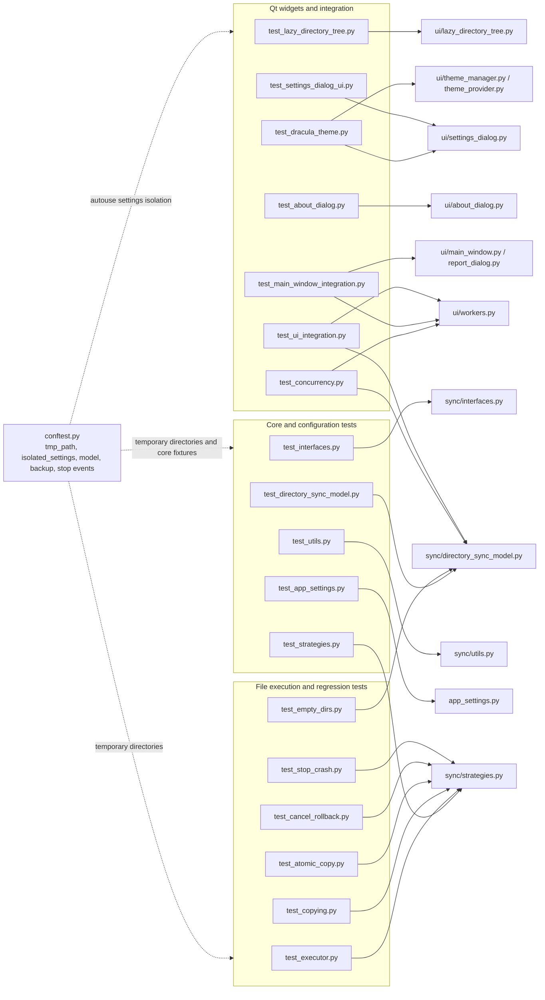

# Test responsibility map

Inspected 2026-10-05. Arrows show the main source responsibility exercised by a test module, not measured coverage percentages.

Sources: [test fixtures](../tests/conftest.py), [pytest configuration](../pyproject.toml), [CI matrix](../.github/workflows/ci.yml). Settings isolation substitutes a temporary YAML path; filesystem tests work with temporary directories. Qt integration tests use pytest-qt.

Some concurrency tests primarily assert absence of crashes or result availability, rather than byte-level integrity and exact cancellation semantics. A test name is not evidence that all races are prevented.

[Atomic copy checks](../tests/test_atomic_copy.py) compare actual source, target and backup contents after success, injected write/backup/installation failures, stop and forced worker termination. Process-pool tests exercise named `partial` tasks under the default start method and `spawn`; operation-owned cleanup must preserve unrelated user files. These checks do not establish crash recovery for the whole application or correctness of overlapping model operations.
