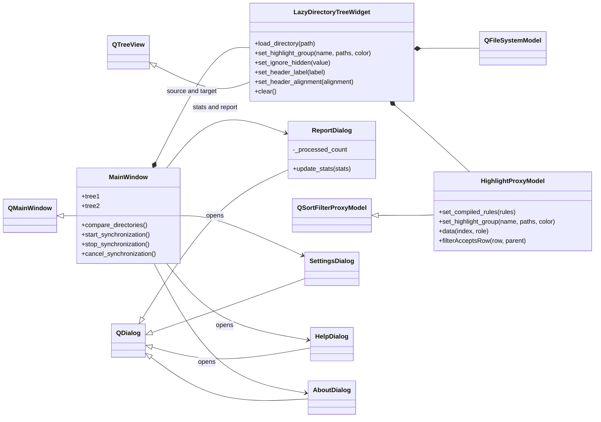
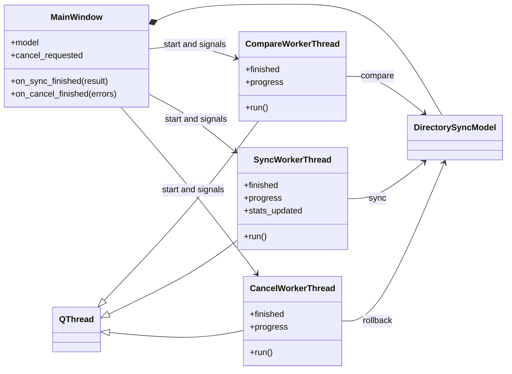
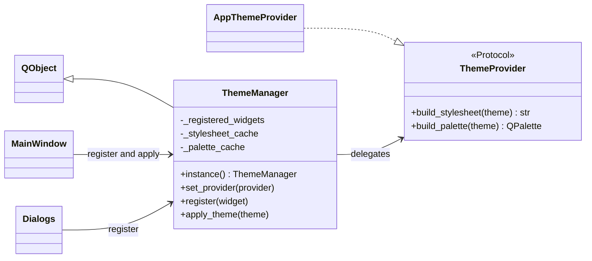

# UI classes and ownership

Current implementation, inspected 2026-10-05. Qt inheritance is explicit; associations show ownership and calls, not guaranteed exclusion between operations.

## Window, trees and dialogs

`ClickableLineEdit` subclasses `QLineEdit` for path selection; `RoundedMenu` subclasses `QMenu` for menu presentation. They are created by MainWindow. Tree data loads through `QFileSystemModel`; regex/highlight behavior belongs to the proxy. Report cursor behavior with capped stats history is an open check, not a solved guarantee.

## Workers and the model

Workers share the window's model. Their custom result signals are emitted before thread exit. The full operation ordering is in [sequence_sync.md](sequence_sync.md).

## Themes

ThemeManager uses weak widget references, cached styles/palettes and animated transitions. Sources: [window](../ui/main_window.py), [workers](../ui/workers.py), [tree/proxy](../ui/lazy_directory_tree.py), [theme manager/provider](../ui/theme_manager.py), [provider implementation](../ui/theme_provider.py).
